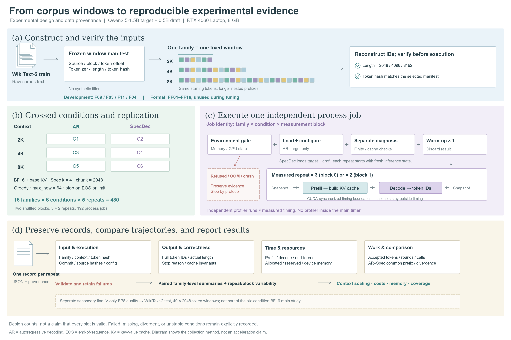
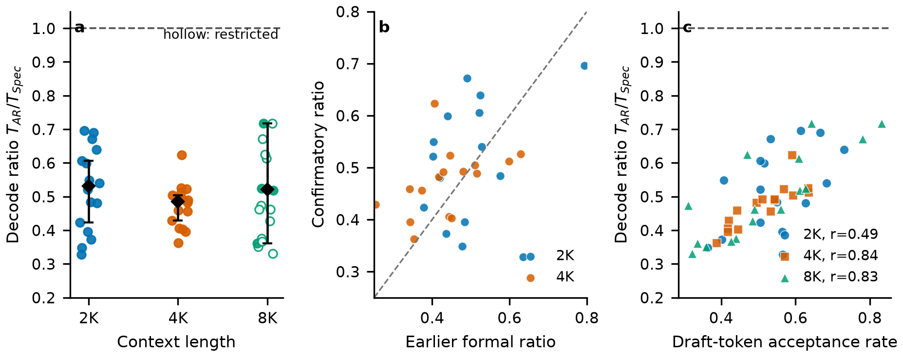

# When Does Speculative Decoding Pay Off? A Context-Length Study on an 8 GB GPU

在 RTX 4060 Laptop 8GB 上实现 Qwen2.5 推理引擎，研究固定模型对、精度与推理配置时，上下文长度如何影响 greedy speculative decoding（SpecDec）相对自回归解码（AR）的性能。DSAI 4207 课程项目。

团队实现了模型前向、KV cache、量化辅助函数与投机解码控制循环；张量运算依赖 PyTorch，权重与 tokenizer 来自 Hugging Face，prefill 融合 attention 使用库提供的 cuDNN 路径。自写推理引擎不等于所有 CUDA 算子均为手写。

## 项目简介

大模型生成文本包含两个工作阶段：**prefill** 处理已有上下文并建立 KV cache，**decode** 使用缓存逐步生成新 token。上下文变长时，两部分的计算量、缓存访问与临时张量需求都会变化。在 8GB 笔记本 GPU 上，理论上更省 target 调用的算法，也可能被 draft 成本、缓存操作或资源压力抵消。

项目在自写推理引擎上构建了一条完整的实验链：先固定配置完成受控对照，再用多组独立的机制实验解释观测结果，最后用诊断性 oracle 分离不同成本来源。所有负结果与失败证据都被保留，没有被后续实验覆盖。

| 问题 | 项目如何回答 |
|---|---|
| 上下文变长后，SpecDec 相对 AR 的收益如何变化？ | 固定模型对与推理配置，在 2K / 4K / 8K 比较 decode 与端到端延迟，这是主实验 |
| 为什么接受率高仍可能不加速？ | 结合接受长度、轮数、target 调用量与独立阶段诊断，拆解省下的 target 工作能否抵消额外成本 |
| KV 压缩是否改变 8K 条件的资源与性能？ | 使用 V-only FP8 作为次要消融，分别测逻辑缓存、显存、延迟与固定文本质量 |
| 批量验证与单步 AR 是否保持同样输出？ | 区分控制逻辑正确性与有限精度数值行为，保留完整 token 序列及分歧证据 |



## 系统如何工作

模型前向的数据流为：

```text
文本 → tokenizer → token IDs [B, S]
     → Embedding [B, S, hidden]
     → 多层 DecoderLayer（RMSNorm / attention / MLP / residual）
     → 最终 RMSNorm → LM head → logits [B, S, vocab]
     → greedy argmax → 新 token → 更新 cache → 下一步
```

`B` 是 batch 大小，`S` 是本次输入长度，不一定是全部历史长度。Attention 中的 RoPE 使用对应位置，GQA 让多个 query heads 共享 KV heads；各层缓存历史 K/V，避免每生成一步都重新计算整个前缀。因果 mask 阻止当前位置读取未来 token。

**Chunked prefill** 将长输入按块处理，并累积各层 KV cache。它不是截断上下文：后续块仍可关注已有历史。分块限制本次 query 长度，prefill-only cuDNN 融合路径进一步减少显式 attention 中间张量；这与是否启用 SpecDec 是两件不同的事。

投机解码的每轮流程为：

```text
已提交前缀
→ draft 按自回归方式提出最多 k 个候选
→ target 批量验证这些候选所对应的预测位置
→ 接受连续匹配的前缀
→ 遇到首个拒绝时，由 target 提供替换 token
→ 按实现契约处理缓存与必要修复
→ 继续下一轮，或因 EOS / 长度预算停止
```

缓存中可能暂时包含尚未提交的候选，因此 `spec_cache.py` 的长度检查和裁剪不是附属功能，而是算法正确性的一部分。未接受候选不能成为后续生成的有效历史。流程细节与出口契约以 [SpecDec 设计](docs/design_freeze_g4_specdec.md) 和 [cache 契约](docs/design_g4_cache_api.md) 为准。

V-only FP8 改变缓存的**存储表示**：K 保持 BF16；每个 token、每个 KV head 的 128 维 V 用 max-abs scale 归一化，再舍入为 E4M3。读取时反量化回计算精度。压缩来自 FP8 payload，而非简单除以 scale；scale 元数据和反量化成本都计入结果。

## 正式实验（confirmatory，2026-10-25）

Frozen configuration（全程未改动）：

| 项目 | 取值 |
|---|---|
| 硬件 | NVIDIA GeForce RTX 4060 Laptop GPU，8GB |
| Target / draft | `Qwen/Qwen2.5-1.5B-Instruct` / `Qwen/Qwen2.5-0.5B-Instruct` |
| 计算精度 | BF16 |
| Attention | `cudnn_prefill` 仅融合 prefill；propose / verify / repair 保持 eager |
| KV | 未量化 BF16（引擎标签 `fp16`） |
| 上下文 | 2,048 / 4,096 / 8,192 tokens（同一 family 的嵌套前缀） |
| Prefill chunk | 2,048 tokens |
| 投机长度 | k = 4 |
| Decode 上限 | 64 greedy tokens，EOS-aware |
| 输入 | `formal-v1`，16 个 held-out family，三档上下文 |
| 重复 | 每个 family×condition 5 次 measured，跨两个测量 block 按 3+2 分配，warm-up 丢弃 |
| 执行 | AR 为 target-only 进程；SpecDec 为双模型进程；seeded AB/BA 串行调度 |

正式主批次已完成 **192 个进程任务、480 条 measured**，无失败任务（冻结证据见 [confirmatory_full_results_2026-10-25.md](docs/confirmatory_full_results_2026-10-25.md)）。

| Context | 可推断 family 数 | 中位 R = T_AR / T_Spec | Bootstrap 95% 区间 | AR decode 中位 (s) | Spec decode 中位 (s) | Spec 更慢 |
|---:|---:|---:|---:|---:|---:|---:|
| 2K | 16 | **0.531** | [0.424, 0.606] | 2.591 | 4.772 | 16/16 |
| 4K | 16 | **0.485** | [0.429, 0.504] | 2.113 | 4.646 | 16/16 |
| 8K | 4 | **0.522** | [0.360, 0.717] | 2.157 | 4.732 | 16/16（描述性） |

用全部 16 个 family 中位数作描述性统计，SpecDec 的 decode 时间约为 AR 的 1.88×、2.06×、2.14×。8K 有 12 个 family 未通过完整的六项计时检查（边界时钟、block 间稳定性、运行内稳定性），因此只有 4 个 family 进入可推断子集；其余 12 个只作描述性留存。所有 family 在三个上下文下都显示 SpecDec 更慢，方向不依赖聚合统计。



工作量为：中位接受率约 0.54 / 0.52 / 0.49，中位轮数约 23 / 23.5 / 24.5；把 block 验证调用与 mismatch 修复调用一并计入后，一次生成约需 39 / 39 / 41 次 target 调用。接受率与 decode 比值在 4K、8K 上的 Pearson 相关约 0.84、0.83，但相关性不构成因果解释。

输出一致性：AR 与 SpecDec 在同一输入下产生完全相同的 64-token 输出，在 2K / 4K / 8K 分别为 3/16、8/16、5/16 个 family；两种模式各自在 16/16 family 上可复现。因此正式结果比较的是"相同配置下两条确定性生成路径的耗时"，不是"相同输出的无损加速"。

## 机制实验链（2026-10-25 至 2026-10-27）

正式结果表明 SpecDec 在所有上下文下都更慢。此后按顺序执行了一组独立实验，逐一排除解释路径：加速失败并非因为接受率低，也不只是因为 target 验证本身慢，更不是因为缺少 CUDA Graph；决定性成本来自 draft 模型的前向本身。

### 1. 执行路径优化（Phase O）

将每轮 8 次同步压缩到 2 次、把 per-step 的 H2D token 拷贝降为 0（GPU token 流、向量化接受判断），decode 时间下降 3.8%–4.5%，但仍慢于 AR。优化后的逐轮账本显示 draft 提议与 repair 仍是主要成本。

### 2. 接受率诊断

在开发 family 上（F09/F03/F11/F04，2K/4K/8K）统计严格接受率：中位 0.579 / 0.599 / 0.429。分析首个不匹配位置的目标模型次优排序：83.5% 的轮次中正确 token 位于 target rank ≤ 5，57.4% 落在 logit 差 ≤ 1.0 的近并列区间——不匹配大多发生在 BF16 数值近并列处。这说明接受率仍有大量可用空间，但也提示"通过更宽松接受规则拿回这些 token"未必改变性能结构。

### 3. Relaxed acceptance（Δ-logit 容忍）

把逐 token 的接受规则从"严格相等"放宽为"候选 token 与 target argmax 的 logit 差在 δ 内"，δ ∈ {0.05, 0.1, 0.3}，并在统计中记录 logit regret 与回滚量。接受率从 0.579 提升到 0.811 / 0.849 / 0.745，但 decode 比值为 0.714 / 0.680 / 0.560，从未超过 1。接受率提升没有转化为速度：轮数与 target 调用量下降有限，repair 调用反而增加，且 token 不再与 AR 逐位相同。结论：接受路径不是瓶颈所在。

### 4. Perfect-acceptance oracle（all-accept）

把每轮候选全部强制接受，把接受率推到上限 1.0，用于测量"在 target 验证形状不变的前提下，SpecDec 的延迟下限"。decode 比值为 0.860 / 0.858 / 0.849（最好单元 0.887）。即使接受率为 100%，依然慢 14%–15%：speculative 模式每个 decode step 需要一次 4-token 的 block verify，其成本高于 AR 的单 token step，draft 提议与 repair 的额外调用进一步叠加。这是该实现结构的**结构性下限**：接受率再高，也无法在这一结构下越过 1.0。

### 5. Bonus-aware all-accept（token 粒度口径）

每轮在 4 个候选之外再让 target 提供一个 free token（accept+1 的粒度），把 64-token 生成所需的轮数从 16 降到 13（52 个候选 token + 12 个 bonus token），验证调用 16→13。decode 比值为 0.912 / 0.931 / 0.874，12 个单元中有 3 个达到 1.01–1.03（跨批次对照，仅作趋势）。与严格路径的逐位一致性 gate 为 11/12，1 个单元因 BF16 舍入并列产生差异（已记录，不放行正式结论）。

### 6. CUDA Graph 局部 A/B

在固定形状下分别对 draft 提链与 target 验证做 CUDA Graph 捕获与回放：draft 16 步提链 3.7–6.0× 加速，target verify 1.4–2.6×；graph kernel 时间与含拷贝的有效时间差 < 2%，即回放本身几乎无额外开销；每个 graph 的保留内存池约 2.0 GiB（draft 链）/ 0.89 GiB（verify）。按这些分量估计的 Amdahl 上界为 2.4–4.4×——该上界建立在固定形状与固定写回的历史上，偏乐观，不能作为端到端 speedup。

### 7. CUDA Graph 端到端可行性（2K）

在 bonus all-accept、2K 条件下让每一轮都走 graph 捕获：26 个逐轮 graph（13 个 chain + 13 个 verify）各需约 2.0 / 0.89 GiB 保留内存，外推约 37.6 GiB，远超 8GB；实际捕获到 8/26 即 OOM。同一批次的 AR 为 2.407 s，eager bonus 为 2.691 s（比值 0.894）。结论：逐轮图捕获在 8GB 上不可行，端到端 CUDA Graph 路线被内存阻断，而非被计算量阻断。

### 8. Draft-free + bonus oracle

为直接测量"draft 前向本身值多少时间"，让 oracle 冻结生成的 64 个目标 token 序列，由 target 在 13 轮验证中回放（每轮 4 候选 + 1 bonus），完全移除 draft 前向。decode 时间 0.555 / 0.545 / 0.540 s，AR 为 2.476 / 2.293 / 2.286 s，S = 4.46 / 4.24 / 4.21。12/12 单元 gate 通过（生成序列与冻结序列逐位相等、`draft_forward_calls = 0`、cache 长度 = ctx+64、draft 常驻、峰值显存 3.82 GiB）。与 bonus oracle 对照（S_AR/S = 0.87–0.92）可以定位：draft 模型的前向计算是决定性成本，验证与 bonus 机制本身只占约 10%。

### 机制链小结

| 实验 | 关键数字 | 回答什么问题 |
|---|---|---|
| 正式 confirmatory | R = 0.531 / 0.485 / 0.522（8K 限 4 family） | SpecDec 是否加速？否，全上下文、全 family |
| Phase O 优化 | decode −3.8%–4.5% | 执行路径开销占多大？存在但不足以反转结论 |
| 接受率诊断 | 严格接受 0.579 / 0.599 / 0.429；近并列 57.4% | 不匹配来自哪里？多为 BF16 数值近并列 |
| Relaxed acceptance | 接受率 → 0.81 / 0.85 / 0.75；R 0.71 / 0.68 / 0.56 | 放宽接受能加速吗？不能 |
| All-accept oracle | R = 0.860 / 0.858 / 0.849 | 完美接受是否够？不够，结构下限 ≈0.85 |
| Bonus all-accept | 轮数 16→13；R 0.912 / 0.931 / 0.874 | 减少轮数能否接近 1？接近但未越过 |
| 局部 CUDA Graph | draft 3.7–6.0×，verify 1.4–2.6× | graph 能回收多少开销？分数开销，但见下行 |
| 端到端 CUDA Graph 2K | 26 图 ≈37.6 GiB → OOM | graph 端到端可行吗？内存阻断 |
| Draft-free oracle | S = 4.46 / 4.24 / 4.21；draft 调用 0 | draft 前向值多少？去掉 draft 即可超越 AR |

## 结论

在冻结的 BF16 Qwen2.5-1.5B / 0.5B、batch=1、k=4、64-token 配置下，SpecDec 在 2K/4K/8K 全部 16 个正式 family 上都慢于 AR（可推断中位 0.531 / 0.485 / 0.522）。后续机制实验给出的解释链为：

1. 接受率不是瓶颈：放宽到 Δ-logit 或强制完美接受，都无法让 SpecDec 越过 AR；
2. 结构成本是主因：speculative 结构每步一次 4-token block verify，比 AR 的单 token step 更重；完美接受下也只能达到 ≈0.86；
3. token 粒度口径（bonus）把轮数从 16 降到 13，最接近盈亏平衡（0.87–0.93），但该路径与 AR 输出不再逐位一致，且 3/12 单元的 1.01–1.03 仅为跨批次趋势；
4. CUDA Graph 在固定形状下可回收大量执行开销，但 8GB 上逐轮图捕获被内存阻断，端到端不可行；
5. 决定性成本是 draft 前向：移除 draft 后（bonus 逐位回放）S 达 4.2–4.5×，说明"更便宜、更准的 draft 生成方式"（如 EAGLE 式特征级/MLP 头 draft、共享 target 前向的轻量 head）才是把 SpecDec 推过 1.0 的方向，而不是继续调接受规则或调度。

这些机制实验均为**诊断性 oracle**：它们分离成本来源，不代表可部署实现，不产生正式 speedup 或质量声明。对外声明以 confirmatory 结果与证据清单为准。

## 测量与证据规范

- **测量边界**：decode 以"进入生成循环 → EOS/长度预算"为界计时；prefill 单独计时；加载不进入推理计时。计时使用 CUDA event，AR 与 Spec 同一输入。
- **重复与随机化**：每个 `(family, condition)` 5 次 measured，跨两个测量 block 3+2 分配；每个进程先做一次 warm-up 并丢弃；AB/BA 调度消除 block 顺序效应。
- **环境门禁**：每次 GPU 计时前检查可用物理内存（commit 阈值 16 GiB）；环境不达标时等待/重试，不绕过。WDDM 下的 `allocated > 8 GiB` 读数不可信，以物理 `mem_get_info` 与 OOM 为准。
- **原始产物**：全部逐次运行记录保存在本地 `output/`（gitignored），每条记录含完整 token 序列、stop reason、cache/control 检查、attention 路径、环境遥测、边界时钟与显存统计；汇总表与统计 JSON 在 `docs/measurements/`。
- **历史证据**：所有历史 FAIL/CHECK/PASS 与公开过的失败原因都保留，后续 PASS 不覆盖旧记录；8K 限制标签、跨批次对照、3 次重复等限制均在对应报告中原样列出。
- **不可用的口径**：插桩、profiler、oracle、fixed-shape graph 微基准的计时不进入正式 speedup；不同配置、不同批次的数字不直接拼接成结论。

## 仓库结构

| 路径 | 内容 |
|---|---|
| `specdec/engine/` | 自写模型、attention、KV cache、量化接入与 greedy SpecDec 控制循环 |
| `specdec/kernels/` | 隔离的 CUDA / Triton 算子研究，不默认等于正式配置所用路径 |
| `experiments/formal/` | 正式 runner、计划/输入/worker、CPU 测试、证据审计 |
| `experiments/confirmatory/` | confirmatory AB/BA 实验：run、pilot/full 分析、就绪审计、测试 |
| `experiments/execution_optimization/` | Phase O 执行路径优化引擎与逐轮账本基准 |
| `experiments/acceptance_diagnostics/` | 严格接受率与近并列分析 |
| `experiments/relaxed_specdec/` | Δ-logit 放宽接受、all-accept、bonus all-accept 三组 oracle |
| `experiments/cuda_graph_local/` | 固定形状下 draft/verify 局部 CUDA Graph A/B |
| `experiments/cuda_graph_e2e/` | 逐轮图捕获端到端可行性实验（2K） |
| `experiments/mechanism/` | draft-free + bonus 完美接受 oracle |
| `docs/` | 设计、冻结协议、实验报告、数据台账、图表与汇总测量 |
| `scripts/` | 正式 family 构建与 CPU 校验、报告生成脚本 |
| `output/` | 原始运行产物（本地，gitignored） |

`docs/figures/` 与 `docs/measurements/` 保存各实验的图表与汇总表；各报告内链接指向对应文件。

## 复现

环境（Windows / PowerShell，本机目标为 PyTorch 2.6.0+cu124 与 RTX 4060 Laptop 8GB）：

```powershell
py -3.11 -m venv .venv
.\.venv\Scripts\Activate.ps1
python -m pip install -U pip
python -m pip install torch==2.6.0+cu124 --index-url https://download.pytorch.org/whl/cu124
python -m pip install -r requirements-local.txt
python -m pip install -e .
python -m specdec.cli env-check
```

所有 GPU 实验串行运行；计时前须通过环境门禁；`output/` 为默认产物目录。

```powershell
# 正式 family 构建与 CPU 校验（需要本地数据与 tokenizer）
python -X utf8 scripts/build_formal_families.py
python -X utf8 scripts/verify_formal_families_cpu.py

# 正式 runner（先 pilot，再 formal；--execute 才会真正运行）
python -X utf8 -m experiments.formal.run --execute --pilot
python -X utf8 -m experiments.formal.run --execute --formal

# confirmatory AB/BA（--expected-commit 指定冻结代码）
python -X utf8 -m experiments.confirmatory.run --execute --input-set pilot
python -X utf8 -m experiments.confirmatory.run --execute --input-set formal --expected-commit <frozen-sha>
python -X utf8 -m experiments.confirmatory.analyze_pilot
python -X utf8 -m experiments.confirmatory.analyze_full
python -X utf8 -m experiments.confirmatory.audit_full_ready

# Phase O 执行优化基准
python -X utf8 -m experiments.execution_optimization.bench_dev
python -X utf8 -m experiments.execution_optimization.analyze_bench

# 接受率诊断 / Δ-logit 放宽 / all-accept / bonus all-accept
python -X utf8 -m experiments.acceptance_diagnostics.run_dev
python -X utf8 -m experiments.relaxed_specdec.run_dev --stage b --role relaxed --family F09 --ctx 2048 --delta 0.1
python -X utf8 -m experiments.relaxed_specdec.run_all_accept --role oracle --family F09 --ctx 2048
python -X utf8 -m experiments.relaxed_specdec.run_bonus_accept --role bonus --family F09 --ctx 2048

# 局部图 A/B（draft / target）
python -X utf8 -m experiments.cuda_graph_local.gate_gpu
python -X utf8 -m experiments.cuda_graph_local.benchmark --family F09 --ctx 2048 --model draft
python -X utf8 -m experiments.cuda_graph_local.benchmark --family F09 --ctx 2048 --model target

# 端到端图可行性（2K，ar / eager / graph）
python -X utf8 -m experiments.cuda_graph_e2e.benchmark_2k --mode ar
python -X utf8 -m experiments.cuda_graph_e2e.benchmark_2k --mode graph

# draft-free + bonus oracle
python -X utf8 -m experiments.mechanism.run_draft_free_oracle --stage full --mode draft_free --family F09 --ctx 2048
python -X utf8 -m experiments.mechanism.analyze
```

各实验目录下的 `analyze*.py` 把 `output/` 原始数据规约为 `docs/measurements/` 中的汇总表与统计 JSON；`test_*_cpu.py` 为可在无 GPU 环境运行的逻辑测试。离线模型加载可设 `$env:HF_HUB_OFFLINE = "1"`（前提：所需文件已缓存）。

## 文档索引

主实验与数据：

- [中文版阶段性技术报告（2026-10-26，PDF）](docs/pdf/specdec_chinese_stage_report_2026-10-26.pdf)（[可编辑 Markdown](docs/specdec_chinese_stage_report_2026-10-26.md)）— 截至 10-26 的阶段汇总：正式结果、成本机制、Phase O、接受率诊断与后续路线
- [Confirmatory 完整结果（2026-10-25）](docs/confirmatory_full_results_2026-10-25.md) — 正式数字、8K 限制、机制证据与声明边界
- [Confirmatory pilot 报告（2026-10-24）](docs/confirmatory_pilot_report_2026-10-24.md)、[测量预注册](docs/confirmatory_measurement_preregistration_2026-10-24.md)、[完整协议](docs/confirmatory_full_protocol_2026-10-25.md)
- [阶段进度与数据分析（2026-10-24）](docs/progress_and_data_analysis_2026-10-24.md)、[数据台账](docs/data_ledger.md)、[G5 测量协议](docs/g5_measurement_protocol.md)

机制实验（按时间顺序）：

- [执行热路径审计（2026-10-25）](docs/specdec_execution_hotpath_audit_2026-10-25.md) / [执行优化报告（2026-10-25）](docs/specdec_execution_optimization_report_2026-10-25.md)
- [接受率诊断（2026-10-26）](docs/acceptance_diagnostics_report_2026-10-26.md)
- [Relaxed SpecDec 机制报告（2026-10-26）](docs/relaxed_specdec_mechanism_report_2026-10-26.md)
- [All-accept 延迟下限（2026-10-26）](docs/all_accept_latency_floor_report_2026-10-26.md)
- [Bonus all-accept oracle 报告（2026-10-26）](docs/bonus_accept_oracle_report_2026-10-26.md) / [设计审计](docs/bonus_accept_design_audit_2026-10-26.md)
- [局部 CUDA Graph A/B 报告（2026-10-26）](docs/cuda_graph_local_ab_report_2026-10-26.md) / [设计审计](docs/cuda_graph_local_ab_design_audit_2026-10-26.md)
- [端到端 2K 图实验报告（2026-10-27）](docs/cuda_graph_e2e_2k_report_2026-10-27.md) / [设计审计](docs/cuda_graph_e2e_2k_design_audit_2026-10-27.md)
- [Draft-free oracle 报告（2026-10-27）](docs/draft_free_oracle_report_2026-10-27.md)

设计与正确性：

- [配置冻结（2026-10-06）](docs/config_freeze_2026-10-06.md)、[正式 runner 规格](docs/formal_runner_spec_2026-10-06.md)、[BF16 准入清单](docs/bf16_formal_admission_2026-10-05.md)
- [SpecDec 设计](docs/design_freeze_g4_specdec.md)、[cache 契约](docs/design_g4_cache_api.md)、[FP8 设计](docs/design_freeze_fp8_kv.md)
- [B6 状态与证据](docs/b6_status_and_evidence_index_2026-10-05.md)、[分层正确性协议](docs/specdec_correctness_protocol_v2_2026-10-04.md)、[正确性归因报告（PDF）](docs/pdf/specdec_correctness_localization_report_2026-10-07.pdf)
- [投机解码教学](docs/specdec_explained.md)（[PDF](docs/pdf/specdec_speculative_decoding_explained.pdf)）

历史归档：`docs/` 中保留旧版计划、每日报告与阶段检查点；其中的配置口径与验收标准不构成当前正式执行合同。性能与质量声明以 confirmatory 结果与 `docs/measurements/` 中的证据为准。

## 已知限制

- 单机、单请求、batch=1、单一 GPU（RTX 4060 Laptop 8GB）；结论不外推到批处理、其他 GPU 或生产 serving 引擎。
- 正式结果是对"两条确定性生成路径的耗时比较"，其中 AR 与 Spec 输出在多数 family 上不一致；不一致由 BF16 形状敏感（M=1 vs M=4）引起，属数值行为而非控制逻辑错误。
- 8K 只有 4 个 family 通过全部计时检查；描述性 8K 数字不与其他上下文合并。
- 机制实验为诊断性 oracle，不可部署；部分数字来自开发 family 与跨批次对照，仅作趋势参考。
- CUDA Graph 的端到端结论是"在 8GB 上不可行"（内存阻断），不是"graph 计算上无效"；未来若采用有界容量/静态 padding 或共享池方案，需要重新测量。

## 后续方向

1. 用更便宜、更准的 draft 生成替代独立 draft 模型前向（如特征级 draft / 共享 target 前向的轻量头 / 检索或 n-gram 回退），这是 draft-free 实验直接指向的路径。
2. 评估静态容量或 padding 的 graph 方案在本模型对上的可行性（图数量与保留内存的固定上界），并以逐位 gate 约束输出一致性。
3. 结束 k 敏感性与上下文效应的辅助分析，作为主实验之外的补充证据。

## 团队与课程信息

DSAI 4207 课程项目。代码与文档由团队成员维护；`docs/pdf/specdec_course_proposal_2026-10-04_final.pdf` 为课程 proposal 提交版，`specdec_frozen_submission_proposal_3members.md` 为冻结提交口径。
