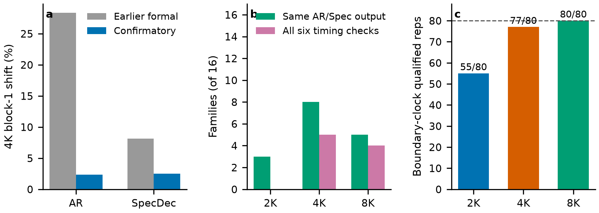
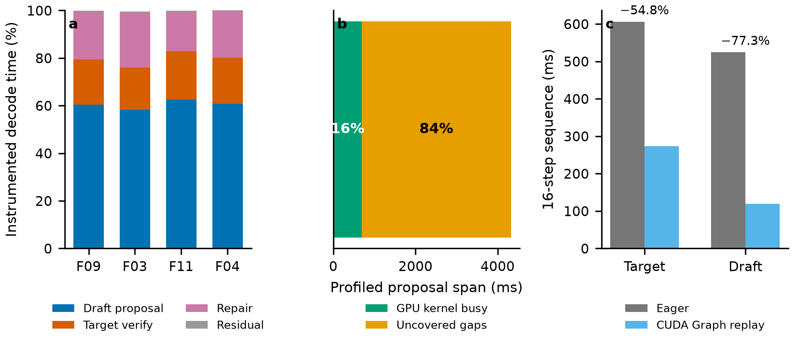

# Confirmatory Speculative-Decoding Results

**Evidence freeze:** 2026-10-25

**Batch:** `20261025T060242Z_a1bd355f`

**Frozen code:** `6c1774a0d86348f3abe16dcd9d79f38831d87564`

**Verdict:** `FORMAL_COMPLETE_WITH_RESTRICTED_8K`

## Executive conclusion

The confirmatory experiment completed all 192 planned jobs and all 480 measured repetitions without a failed job. Under the frozen Qwen2.5-1.5B target / Qwen2.5-0.5B draft configuration, speculative decoding was slower than autoregressive decoding for every one of the 16 held-out prompt families at 2K, 4K, and 8K context. The median decode ratios, defined as \(T_{AR}/T_{Spec}\), were 0.531 at 2K and 0.485 at 4K. All ratios were below one, so the direction of the finding does not depend on an aggregate statistic or a small number of outliers.

At 8K, only four families satisfied all six timing checks. Their reportable median ratio was 0.522 with a bootstrap 95% interval of [0.360, 0.717]. All 16 families remain available for descriptive accounting and all 16 were slower under SpecDec, but the 12 restricted families are not promoted to the same inferential status. Their inclusion gives a descriptive all-family median of 0.468.

The confirmatory run strengthens the main performance conclusion and clarifies why it occurs. Acceptance remains substantial, but the implementation executes many short draft-proposal and repair calls. Prior stage instrumentation assigns roughly 59–63% of instrumented decode time to draft proposal and another 17–23% to repair. An Nsight diagnostic on one representative 2K case found GPU kernels active for only about 16% of the proposal span, while a same-adapter CUDA Graph diagnostic reduced a 16-step draft sequence by 77.3%. These diagnostics identify launch/dispatch and fine-grained execution overhead as plausible optimization targets; they do not establish an end-to-end production speedup.

## 1. Frozen experimental design

| Item | Frozen value |
|---|---|
| Hardware | NVIDIA GeForce RTX 4060 Laptop GPU, 8 GB |
| Target / draft | Qwen2.5-1.5B-Instruct / Qwen2.5-0.5B-Instruct |
| Compute | BF16 |
| Attention | `cudnn_prefill` for prefill only; propose, verify, and repair remain eager |
| Target and draft KV | Uncompressed BF16 (`fp16` is the historical engine label) |
| Contexts | 2,048 / 4,096 / 8,192 tokens |
| Prefill chunk | 2,048 tokens |
| Speculation length | \(k=4\) |
| Decode limit | 64 greedy tokens, EOS-aware |
| Inputs | 16 frozen formal families, each evaluated at all three nested context lengths |
| Repetition plan | Five measured repetitions per family-condition, split 3+2 across two blocks; warm-ups discarded |
| Primary metric | Decode ratio \(T_{AR}/T_{Spec}\); values above one mean SpecDec is faster |
| Execution | Independent AR target-only and SpecDec dual-model processes in a seeded AB/BA schedule |

The output sequences, stop reasons, cache/control checks, attention-path use, environment telemetry, timing boundaries, and memory statistics were retained for every measured repetition. Diagnostic runs were not substituted for timed runs.

## 2. Primary performance result

| Context | Families | Reportable ratios | Median \(T_{AR}/T_{Spec}\) | Bootstrap 95% interval | Median AR decode (s) | Median Spec decode (s) | Spec slower |
|---:|---:|---:|---:|---:|---:|---:|---:|
| 2K | 16 | 16 | 0.531 | [0.424, 0.606] | 2.591 | 4.772 | 16/16 |
| 4K | 16 | 16 | 0.485 | [0.429, 0.504] | 2.113 | 4.646 | 16/16 |
| 8K | 16 | 4 | 0.522 | [0.360, 0.717] | 2.157 | 4.732 | 16/16 descriptively |

Equivalently, using all 16 family medians descriptively, SpecDec required approximately 1.88×, 2.06×, and 2.14× the AR decode time at 2K, 4K, and 8K. The 8K multiplier is descriptive because 12 families did not pass all timing checks.

**Figure 1. Speculative decoding is slower for every formal family under the frozen configuration.** (a) Each point is one family; black diamonds and intervals show the reportable median and bootstrap interval. Hollow 8K points are retained descriptively but restricted from the primary timing claim. (b) The independent confirmatory measurements preserve the direction of the earlier formal result at 2K and 4K. (c) Higher acceptance is associated with a less severe slowdown, especially at 4K and 8K, but the observational correlation is not a causal estimate.

## 3. Work-volume and output behavior

Median acceptance rates were approximately 0.54, 0.52, and 0.49 at 2K, 4K, and 8K. The corresponding median round counts were 23, 23.5, and 24.5. A typical generation therefore required about 39, 39, and 41 target invocations when block-verification calls and mismatch-repair calls are counted together. Reducing the number of target calls was not enough to offset draft-model and control-path overhead.

Across families, the Pearson correlation between acceptance and decode ratio was 0.49 at 2K, 0.84 at 4K, and 0.83 at 8K. This supports acceptance as an important moderator of performance, but it does not show that acceptance alone causes the observed latency: both variables can co-vary with text content, generated trajectory, round count, and repair behavior.

AR and SpecDec generated identical 64-token outputs for 3/16 families at 2K, 8/16 at 4K, and 5/16 at 8K. Each mode was independently repeatable for 16/16 families at every context. Consequently, the timing result is a comparison between two deterministic generation strategies under matched inputs and configurations, not a claim of lossless speedup at identical output. The project should report output divergence alongside timing rather than erase divergent families after observing the result.

## 4. Measurement validity and 8K restriction

The earlier formal collection suffered a large 4K block-era shift: median block-1 versus block-0 decode time changed by +28.4% for AR and +8.1% for SpecDec. The confirmatory AB/BA collection reduced those medians to +2.4% and +2.5%. Order effects were also much smaller than the observed slowdown: first-position versus second-position effects were +1.0%/+5.6% at 2K, −2.0%/+1.1% at 4K, and −0.8%/+8.0% at 8K for AR/SpecDec respectively.

All 240 AR repetitions passed the boundary-clock criterion. SpecDec passed 55/80 repetitions at 2K, 77/80 at 4K, and 80/80 at 8K. The 2K failures were low boundary-clock readings on a relatively short workload. The audit samples the process boundary rather than continuously certifying clocks during the timed interval, so these readings are treated as protocol evidence, not as proof that the GPU ran slowly throughout decoding.

At 8K, only 4/16 families passed the combined within-run, between-block, and boundary checks for both modes. This is why 8K remains in the study but receives a restricted inferential label. It is not omitted, replaced, or silently pooled with 2K/4K.

**Figure 2. The confirmatory schedule reduces the earlier block confound, while timing qualification remains context dependent.** (a) Median 4K block shifts before and after the confirmatory AB/BA design. (b) Output identity and all-six timing qualification are distinct criteria. (c) SpecDec boundary-clock qualification by context; all records contain complete boundary evidence.

## 5. Mechanistic evidence

Three independently collected diagnostics explain why fewer target calls did not translate into speedup:

1. **Stage ledger.** Across four development families at 2K, draft proposal consumed 58.5–62.6% of instrumented decode time. Target verification consumed 17.8–20.2%, while target-plus-draft repair consumed 16.5–22.9%.
2. **GPU trace.** In the F09 2K proposal path, 691.4 ms of a 4,321.7 ms profiled span was covered by GPU kernels. The remaining 3,630.2 ms appeared as uncovered gaps in this trace. This is evidence of fine-grained execution and dispatch gaps, not a complete CPU attribution.
3. **CUDA Graph diagnostic.** Holding the adapter and 16-step workload fixed, graph replay reduced target sequence time from 605.8 to 273.9 ms (−54.8%) and draft time from 524.2 to 118.9 ms (−77.3%). This isolates a large replayable overhead component, but it is not the production SpecDec loop and must not be quoted as end-to-end speedup.

**Figure 3. Fine-grained draft and repair execution dominates the observed implementation cost.** (a) Instrumented stage shares for four 2K development families. (b) Kernel-covered and uncovered portions of one F09 proposal trace. (c) Same-adapter CUDA Graph diagnostic, showing the optimization headroom associated with replaying a fixed short-call chain.

These results support the following mechanism statement:

> In this single-request, batch-1 implementation, speculative decoding reduces some target-model work but replaces it with a long chain of short draft, verification, rollback, and repair operations. Their cumulative dispatch and synchronization cost exceeds the saved target work at all tested context lengths.

The evidence does **not** justify the broader statements that speculative decoding is generally ineffective, that the workload is purely memory-bound, or that CUDA Graphs would necessarily make the complete system faster than AR.

## 6. Relation to earlier results

The confirmatory batch is not a duplicate of the first formal batch. It uses the same frozen model pair and primary question, but adds a seeded AB/BA schedule, strict family pairing, complete 3+2 block coverage, and a clean frozen commit. Relative to the earlier formal medians, the confirmatory ratio moved from 0.487 to 0.531 at 2K and from 0.436 to 0.485 at 4K. The exact magnitude changed, but the scientific direction did not: every family remained below one.

The earlier operator diagnostics answer a different question from the formal timing experiment. Formal data establish **whether** the frozen SpecDec system accelerates decoding across held-out families. Stage ledgers, Nsight, and CUDA Graph controls investigate **where** its time is spent and **which overhead class** may be reducible. They should appear as linked but separately labelled evidence in the report.

## 7. Claims suitable for the final paper

The following claims are supported:

- Under the frozen BF16 Qwen2.5-1.5B/0.5B, batch-1, \(k=4\), 64-token configuration, SpecDec was slower than AR for all 16 held-out families at 2K, 4K, and 8K.
- The primary 2K and 4K median decode ratios were 0.531 and 0.485. The 8K reportable subset median was 0.522; all-family 8K summaries are descriptive.
- Acceptance varies with family and is positively associated with the decode ratio, but no tested family crosses the speedup threshold.
- The implementation spends most of its measured SpecDec time in draft proposal and repair, and independent diagnostics expose substantial short-call/dispatch overhead.
- The confirmatory AB/BA schedule substantially reduced the large 4K block shift observed in the earlier collection.

The following claims are not supported:

- lossless identical-output acceleration;
- a universal conclusion about speculative decoding, other GPUs, batching regimes, or optimized serving engines;
- a formal end-to-end CUDA Graph benefit;
- a causal claim that acceptance alone determines speed;
- an unrestricted 8K speedup estimate across all 16 families.

## 8. Recommended paper narrative

The cleanest story is a negative systems result with a mechanism analysis:

1. **Question:** Does a fixed small-draft/large-target speculative decoder become more beneficial as context grows on a constrained laptop GPU?
2. **Controlled result:** No. Across 16 held-out families, all observed family ratios stay below one at 2K, 4K, and 8K.
3. **Why the intuitive prediction fails here:** Acceptance is not sufficient. The saved target calls are outweighed by repeated draft proposal and mismatch-repair work implemented as many short eager operations.
4. **Validation:** A confirmatory AB/BA experiment reproduces the direction while reducing the earlier block-era confound.
5. **Actionable implication:** Future work should first reduce proposal/repair dispatch overhead—through graph capture, fused kernels, or a different drafting architecture—before expecting larger contexts alone to create a speedup crossover.

## 9. Reproducibility artifacts

- Frozen manifest: [`measurements/confirmatory_evidence_manifest_2026-10-25.json`](measurements/confirmatory_evidence_manifest_2026-10-25.json)
- Context summary: [`measurements/confirmatory_context_summary_2026-10-25.csv`](measurements/confirmatory_context_summary_2026-10-25.csv)
- Family-pair summary: [`measurements/confirmatory_pair_summary_2026-10-25.csv`](measurements/confirmatory_pair_summary_2026-10-25.csv)
- Family timing: [`measurements/confirmatory_family_timing_2026-10-25.csv`](measurements/confirmatory_family_timing_2026-10-25.csv)
- Block shifts: [`measurements/confirmatory_block_shifts_2026-10-25.csv`](measurements/confirmatory_block_shifts_2026-10-25.csv)
- AB/BA order effects: [`measurements/confirmatory_order_effects_2026-10-25.csv`](measurements/confirmatory_order_effects_2026-10-25.csv)
- Earlier-versus-confirmatory pairs: [`measurements/confirmatory_old_new_comparison_2026-10-25.csv`](measurements/confirmatory_old_new_comparison_2026-10-25.csv)
- Figure-generation script: [`../scripts/finalize_confirmatory_results.py`](../scripts/finalize_confirmatory_results.py)

The raw 480-record batch remains outside Git because of its size. Its exact location at freeze time and an aggregate content hash are recorded in the evidence manifest.
