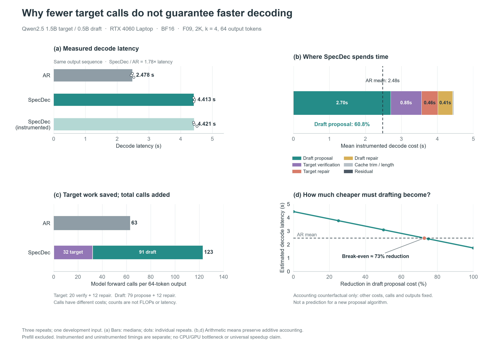

# 阶段进度与数据分析：从正式采集到成本机制验证

更新日期：2026-10-24（Asia/Hong_Kong）。本文面向协作者，区分正式主实验、开发性诊断和工程可行性原型。不是新协议，也不替代原始数据或正式统计分析。

## 1. 当前结论

**正式 BF16 六条件数据已采齐，但统计解释与声明资格尚未全部完成。** 开发诊断支持：减少 target 调用不保证减少延迟；当前实现中 draft 提案是最大的额外成本。GPU 时间线与对称 CUDA Graph 干预进一步支持，细粒度执行的提交与衔接开销是重要因素之一。

**尚未实现或证明：** 完整生成中的 Graph 加速、同等优化后 SpecDec 超过 AR、所有输入共享同一硬件瓶颈、memory-bound/compute-bound 的硬件计数器归因、EAGLE-2 复现。

| 工作 | 状态 | 不能混同的边界 |
|---|---|---|
| 模型、cache、greedy SpecDec | 已实现，有限范围正确性证据保留 | 不保证生产批量验证与 AR 全局逐 token 相等 |
| 正式 runner / pilot / 主采集 | 主采集192任务、480条完成 | 完整记录不等于稳定性全过或加速成立 |
| 上下文主结果 | 六条件描述性统计已核对 | 不是跨family配对效应估计；8K比值抑制 |
| K/V量化研究 | V-only FP8冻结，K-FP8负结果记录 | 历史eager证据不自动转移至新后端 |
| 四开发输入阶段成本 | 有历史跨输入支持 | 不是新逐轮账本完整复测 |
| Nsight Systems | 已打通真实kernel/API/NVTX采集 | profiler会扰动运行，不进入正式计时 |
| Graph单步与16步增长历史 | 独立原型验证通过 | 固定token前向，不是自由生成、回滚与EOS验证 |
| 新跨family逐轮账本 | 两次批次受环境门阻断 | 仅F09 AR完成，不能报告全组复测成功 |
| EAGLE-2 | 仅提出可行性审计方向 | 尚未确认匹配1.5B检查点，未下载或运行 |

## 2. 正式研究范围与数据设计

主问题：**固定模型对、精度和推理实现时，上下文长度如何影响 greedy SpecDec 相对 AR 的性能？**

- Target：Qwen2.5-1.5B-Instruct；draft：Qwen2.5-0.5B-Instruct；RTX4060 Laptop 8GB。
- BF16计算；未量化BF16 KV。引擎字符串`fp16`表示未量化基线，不表示本实验采用FP16计算。
- `cudnn_prefill`仅prefill融合，其余decode/propose/verify/repair走原eager路径。
- 长度2048/4096/8192 × AR/SpecDec = 六条件；k=4，chunk=2048，max_new=64，greedy/EOS规则固定。
- AR为target-only进程，SpecDec为双模型进程；加载不计入推理计时。
- 正式16个FF输入来自WikiText-2 train冻结窗口，2K/4K/8K同起点嵌套前缀并校验hash。开发输入F09/F03/F11/F04不进入正式输入集。
- 每family×condition合计5次measured，跨两个随机block按3+2分配；每job一次warm-up丢弃，共192进程任务、480测量槽位。
- FP8为独立次要消融；profiler与诊断不是正式速度样本。

[可编辑SVG](figures/experiment_workflow.svg)。图中480为设计数量；实际记录与结论资格另行审核。

## 3. 正式采集：记录完整，但结论需要分层

批次：`7f832b6b85274e15ba41577b462650eb`，clean commit `82dd4b2fc8de5c8ba87470921335e2d4642eed3f`。
离线审计192任务、480 measured、12205项检查。原始数据不修改。精简汇总见[六条件CSV](measurements/formal_cells_2026-10-24.csv)。

下表是**每条件80条记录的描述性中位数**，不是每family配对效应或显著性分析；各列中位数不能机械相加。

| 长度 | 策略 | Prefill s | Decode s | Total s | Allocated峰值 GiB |
|---|---|---:|---:|---:|---:|
| 2K | AR | 0.285 | 2.393 | 2.678 | 3.532 |
| 2K | SpecDec | 0.397 | 4.885 | 5.319 | 4.481 |
| 4K | AR | 0.571 | 2.232 | 2.804 | 3.588 |
| 4K | SpecDec | 0.799 | 5.113 | 5.910 | 4.561 |
| 8K | AR | 1.255 | 2.234 | 3.498 | 3.702 |
| 8K | SpecDec | 1.791 | 5.073 | 6.866 | 4.718 |

必须同时披露：

- 进程内CHECK：41/192；跨block CHECK：32/96；至少一项稳定性CHECK：57/96，不可相加。
- 边界遥测完整480/480；边界时钟合格461/480，不等于计时全程高频。
- 同模式跨重复输出改变0/96；AR与Spec输出全同的family数为2K 3/16、4K 8/16、8K 5/16。
- 8K比值按route C抑制，保留原始耗时与资源行；不挑选快样本、不删除慢记录。
- 正式审计中的速度声明资格仍为false。上述描述不应改写为“正式证明全部条件减速”或“8K加速比”。

## 4. 成本收支：target调用减少，为何仍慢？

F09独立账本案例：AR decode中位约2.478s，SpecDec约4.413s，64个输出token相同。
Target前向63→32（20验证+12修复）；加入79次draft提案和12次draft修复后，总模型前向123次。
调用成本不同，不能把调用次数当作FLOPs或时间。

该旧F09账本脚本加载draft后再测AR，因此其AR是**双模型驻留下的单模型计算**，不是严格target-only进程基线；保留为局部诊断案例，不与正式或新独立角色数据池化。

[可编辑SVG](figures/specdec_cost_story.svg)。图a为中位数与原始点；图b/d为可加均值；图d约73%的draft降本阈值是固定其他工作量的账面反事实，不是算法预测，且沿用上述驻留受限的AR参照。

## 5. 跨输入证据：并非只在F09观察到

另一个历史批次`20261023T075505Z_a64b2ec3`确为独立AR target-only与Spec双模型进程。本轮重新核查输入hash、角色驻留、重复输出、诊断/参考工作量、阶段加法；详见[历史原始记录审计CSV](measurements/historical_family_cost_audit_2026-10-24.csv)。

| 输入 | AR中位s，3次 | Spec参考s，1次 | Draft占诊断均值 % | 双侧修复 % | 诊断均值相对Spec参考 % | 共同前缀/64 |
|---|---:|---:|---:|---:|---:|---:|
| F09 | 2.320 | 4.940 | 60.4 | 19.9 | -6.7 | 64 |
| F03 | 2.496 | 4.736 | 58.5 | 22.9 | +6.8 | 1 |
| F11 | 2.502 | 4.282 | 62.6 | 16.6 | -0.4 | 64 |
| F04 | 2.267 | 4.389 | 60.8 | 19.4 | +9.8 | 64 |

**支持：** 四个开发输入的同步诊断中draft都是最大阶段，约58%–63%。
**边界：** 每输入仅1次未插桩Spec参考、3次阶段诊断；固定角色顺序，非正式随机化设计；负差值不是“负插桩开销”；F03为发散轨迹。不能凭此宣称四输入具有相同硬件瓶颈。

新逐轮账本重测在`20261023T204321Z`和用户授权重试`20261023T204641Z`均于F09 target加载后被16GiB live commit门拦截（11.98/12.85GiB），不是CUDA OOM。未运行其余family与ledger。16GiB的加载后重复检查由新工具加入，不是原协议全部阶段的通用门槛；下一步应核对阶段资源预算，而不是机械降低阈值或盲重试。

## 6. 从观察到干预：GPU时间线与Graph

### 6.1 实际kernel采集

PyTorch 2.6.0+cu124构建带`LIBKINETO_NOCUPTI`，尽管CUPTI DLL存在，torch.profiler无法提供kernel时间线。
独立NVIDIA Nsight Systems 2024.2.3.38便携版已验证可用；Windows采集通过UAC管理员权限执行。未更换驱动或PyTorch。

F09真实Spec轨迹trace中：draft每候选约1155个kernel，propose窗口4.322s，kernel执行并集0.691s（16%）。
Trace总墙钟约为参考运行1.43倍，因此16%不能直接外推正常运行。非kernel覆盖时间不等于CPU时间；API耗时除以间隙不等于二者交集。仍未以硬件计数器证明memory/compute bound。

### 6.2 对称Graph原型与有效重测

模型分别独立测试，F09 2K历史接续16个真实固定token，位置2048..2063，长度2048→2064。
三臂：A原eager，B同静态适配器eager，C同适配器Graph。独立诊断中16步logits与新增K/V逐位一致，原历史保持。

旧连续实验中A/B计时误执行历史`torch.equal`、C没有，旧提速与摊销结论作废。问题属于诊断工具不对称计时，不是模型数学错误。
已分离timing/diagnostic接口并补防回归（37/0）；以下只引用修复后批次`batch_remeasure_20261023_202936`，两block、每臂每block5次序列。

| 模型 | A 16步ms | B 16步ms | C 16步ms | B→C耗时下降 | Graph draft/target |
|---|---:|---:|---:|---:|---:|
| Target | 639.25 | 605.84 | 273.90 | 54.8% | — |
| Draft | 557.74 | 524.20 | 118.85 | 77.3% | 0.434 |

精确表见[修复后六格CSV](measurements/cudagraph_chain_corrected_2026-10-24.csv)。这是固定token前向微基准，不执行自由生成argmax反馈或EOS停止。

- C/B kernel数基本相同；短trace中kernel执行时间相近，主机提交与间隙明显减少。
- 支持提交/衔接开销是重要因素，不意味着所有间隙均来自Python，也不意味着Graph融合了kernel。
- Target也显著受益，完整比较必须是同等优化后的AR与SpecDec。
- 每模型16张精确长度图；capture约1.988/1.936s；allocated额外1072/528MiB。模型分别测试，不是双模型同时驻留通过。
- 相对B，单次重放节省约0.332/0.405s，capture-only约6.0/4.8次序列复用打平；完整setup还需另计。单次使用计入捕获仍净亏。
- 图不自动适配其他长度、输入历史和回滚；不能直接把微基准收益当成完整SpecDec加速。

## 7. 次要消融与研究支线

- 历史V-only FP8：K BF16、V E4M3，40×2048-token WikiText-2 test质量窗，ΔNLL +0.000397，相对ΔPPL +0.040%；target逻辑KV在8K由224→169.75MiB，约1.32倍。不是完全无损，也不是整模型压缩；新后端需独立回归。
- K-FP8/full-FP8在所测配置下质量损伤明显，作为负结果保留，不外推所有K量化方法。
- k=2在2K未稳定胜过k=4；1K部分开发输入有改善，仍未胜过AR；不同前缀终点对应不同续写任务，不把差异单独归因上下文长度。
- EAGLE-2仅拟作独立可行性审计：先确认匹配具体1.5B target的特征提议器权重、依赖和显存。不能直接复用其他target的头；未确认匹配检查点，不宣称已复现，也不改正式模型对。

## 8. 下一步优先级

1. 完成正式六条件family级配对、稳定性分层与受限报告，保留8K route C纪律；主报告不能被优化工程阻塞。
2. 核查新跨family工具的阶段内存门语义和剩余预算，决定如何安全继续，不把环境拒绝当作推理失败。
3. 需要扩展机制证据时再补新逐轮账本；现有历史四输入已支持“draft为最大阶段”，不重复声称只有F09证据。
4. Graph先做图内存复用、捕获摊销和状态管理审计，再决定自由生成。固定容量/padding/mask可能改变数值路径，须独立验证。
5. EAGLE-2与memory-bound计数器研究均为可选支线，不替代当前课程主问题，不自动启动训练或系统环境改动。

## 9. 产物与版本说明

本次GitHub同步只发布文档、小体积派生CSV、图与来源摘要；不上传数据集、模型、Nsight二进制、SQLite或大trace。
实验原始文件保存在本地`output/`（gitignored），来源清单与SHA256见[证据索引](measurements/progress_evidence_2026-10-24.json)。
主正式批次对应clean `82dd4b2`；后续开发实验来自dirty工作树并记录源码hash。本次文档提交不等于实验代码已经发布或开发结果由新的clean commit重新运行。尚未审查的引擎/实验代码改动留在工作区，未随文档更新提交。

同步内容可作为协作者阅读入口；原始详细诊断报告中的旧数值、日期标签和已撤回表述应结合本页的修正与范围阅读。所有文件名中的2026-10-23标签保留，本文按香港时间更新为2026-10-24。
