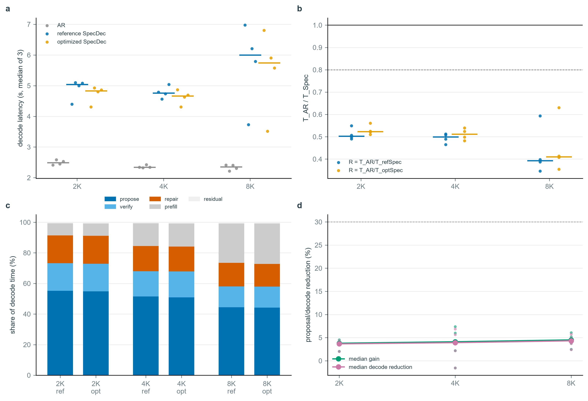
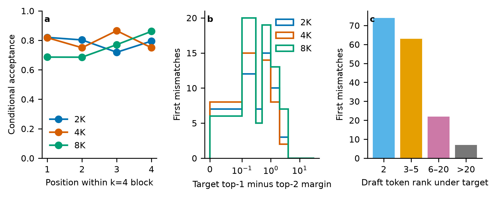

# SpecDec 项目阶段性技术报告

**副标题：受限单卡环境下，固定模型对投机解码的上下文扩展、执行成本与接受行为分析**  
**更新日期：2026-10-26（Asia/Hong_Kong）**  
**项目成员：Fang Chuming、Cheng Shuyue 及项目合作者**

## 摘要

本项目在 NVIDIA RTX 4060 Laptop GPU（8 GB）上实现并评估一个从零构建的 Qwen2.5 推理与投机解码系统。当前主研究问题是：在固定模型对、计算精度和推理配置下，上下文长度如何影响 greedy speculative decoding（SpecDec）相对于 autoregressive decoding（AR）的解码性能。系统以 Qwen2.5-1.5B-Instruct 为 target、Qwen2.5-0.5B-Instruct 为 draft，采用 BF16 计算、未量化 BF16 KV cache、仅 prefill 使用 `cudnn_prefill`，decode/propose/verify/repair 保持 eager 执行。

确认性实验完成了全部 192 个进程任务和 480 次 measured repetition。结果显示，在 16 个冻结且未参与调试的正式 family 上，2K、4K 和 8K 的全部 family 均观察到 SpecDec 慢于 AR。主指标定义为 \(T_{AR}/T_{Spec}\)，2K 和 4K 的中位数分别为 0.531 和 0.485；8K 中满足全部计时检查的 4 个 family 中位数为 0.522，其余 8K 数据仅保留作描述性证据。机制分析表明，SpecDec 虽减少了部分 target 调用，却引入大量短 draft proposal、verification、rollback 和 repair 操作。开发集阶段账本中，draft proposal 占 instrumented decode time 的约 59%-63%；代表性 proposal trace 中 GPU kernel 仅覆盖约 16% 的时间跨度。

Phase O 在不改变输出语义的前提下，将每轮同步类操作从约 8 次降至 2 次，并消除了 token 的 host-to-device copy，但端到端 decode 仅改善约 3.8%-4.5%，不足以跨过 AR break-even point。进一步的 acceptance diagnostics 在 12/12 条开发条件上保持与无诊断参考轨迹逐 token 一致，发现大部分首次拒绝并非 BF16 近贴边导致：仅 11.9% 的首次 mismatch 具有不超过 0.1 的 target top-1/top-2 margin，而 61.4% 超过 0.3；与此同时，81%-88% 的被拒 draft token 仍位于 target top-5。该结果说明，当前负结果同时受到真实 draft-target 预测差异和细粒度执行开销影响。

## 1. 项目目标与当前范围

项目最初同时探索自研推理引擎、长上下文、KV cache 压缩和投机解码。为使最终结论更清晰，当前正式主线收敛为一个固定配置下的性能问题：

> 在固定 Qwen2.5-1.5B/0.5B 模型对、BF16 精度、batch 1、greedy decoding 和固定 \(k=4\) 条件下，上下文从 2K 增长到 4K 和 8K 时，SpecDec 相对于 AR 的解码性能如何变化？

V-only FP8 KV 保留为独立次要消融，K-FP8 的质量失败作为负结果记录。CUDA Graph、执行路径优化、acceptance margin 和 relaxed verification 均属于机制解释或后续探索，不替代正式主问题。

## 2. 系统实现与数据流

### 2.1 模型前向链路

输入文本首先由 tokenizer 转为 token IDs。Embedding 将离散 token ID 映射为 hidden vector，随后每个 DecoderLayer 依次执行 RMSNorm、Q/K/V 投影、RoPE、GQA attention、残差连接和 MLP。每层生成的 K/V 被写入 cache，最终 hidden states 经 RMSNorm 和共享 embedding 权重形式的 LM head 投影为 vocabulary logits。AR 每次根据最后一个位置的 logits 选择一个 token；SpecDec 则让 draft 先连续提出最多 4 个 token，再由 target 一次 block forward 验证。

### 2.2 SpecDec 单轮控制

每轮 SpecDec 包含四类工作：

1. **Proposal：** draft 依据当前历史连续提出 \(k\le4\) 个候选 token。
2. **Verification：** target 对整个候选 block 做一次前向，获得每个位置的判断 logits。
3. **Acceptance：** 从第一个候选开始与 target greedy token 比较，保留最长一致前缀。
4. **Rollback/repair：** 若第 \(m\) 个候选首次不一致，则丢弃其后候选，trim 两侧 cache，并用 target token 修复 target 和 draft 状态。

严格 greedy SpecDec 只有在 draft token 等于 target argmax 时才接受，因此能够维持预定控制语义，但任一早期 mismatch 都会使后续候选失效。

### 2.3 数据集与 family

正式输入从 WikiText-2 train raw corpus 中构建。一个 family 对应一个冻结窗口，2K、4K、8K 为相同起点的嵌套前缀，不插入 synthetic filler。manifest 保存 source、block、token offset、长度和 token hash；worker 在运行前重建 token IDs，并验证长度与 hash。

- 开发 family：F09、F03、F11、F04，仅用于调试和机制诊断。
- 正式 family：FF01-FF16，冻结后未用于调参。
- 质量消融：WikiText-2 test 的固定窗口，与正式性能输入分离。

**图 1. 从 corpus window 到可复核证据的完整流程。** 图中 480 是正式设计数量，不代表每条记录都自动具备相同声明资格；失败、缺失、分歧或不稳定条件均被保留。

## 3. 正式实验设计

| 项目 | 冻结值 |
|---|---|
| Hardware | NVIDIA GeForce RTX 4060 Laptop GPU, 8 GB |
| Target / draft | Qwen2.5-1.5B-Instruct / Qwen2.5-0.5B-Instruct |
| Compute | BF16 |
| Attention | prefill 使用 `cudnn_prefill`；其余阶段 eager |
| KV cache | target 与 draft 均为未量化 BF16 |
| Context | 2,048 / 4,096 / 8,192 tokens |
| Chunk / k | 2,048 / 4 |
| Decode | greedy，最多 64 tokens，EOS-aware |
| Inputs | 16 个正式 family，各自具有 2K/4K/8K 嵌套前缀 |
| Repetition | 每 family-condition 共 5 次 measured，跨两个 block 按 3+2 分配 |
| Primary metric | \(T_{AR}/T_{Spec}\)，大于 1 才表示 SpecDec 更快 |
| Process isolation | AR target-only；SpecDec target+draft；独立进程和 seeded AB/BA schedule |

独立诊断、profiler 和 correctness probe 不进入正式 timing。每次 measured repetition 保存输入 hash、完整输出 token IDs、实际长度、停止原因、cache/control checks、prefill/decode/end-to-end 时间以及显存与环境信息。

## 4. 确认性主结果

确认批次完成 192/192 个任务和 480/480 次 measured repetition，没有 failed job。

| Context | 正式 family | 可报告 ratio | 中位 \(T_{AR}/T_{Spec}\) | Bootstrap 95% interval | AR decode 中位数 | Spec decode 中位数 |
|---:|---:|---:|---:|---:|---:|---:|
| 2K | 16 | 16 | 0.531 | [0.424, 0.606] | 2.591 s | 4.772 s |
| 4K | 16 | 16 | 0.485 | [0.429, 0.504] | 2.113 s | 4.646 s |
| 8K | 16 | 4 | 0.522 | [0.360, 0.717] | 2.157 s | 4.732 s |

所有 family 的观察 ratio 均小于 1。若仅作描述性换算，SpecDec 在 2K、4K、8K 分别约需要 AR 的 1.88 倍、2.06 倍和 2.14 倍 decode time；8K 的 all-family 数字不得提升为无条件推断，因为 12 个 family 未满足全部计时检查。

**图 2. 冻结配置下，所有正式 family 都没有跨过加速阈值。** 2K 和 4K 的确认批次支持正式主结论；8K 空心点为受限描述。接受率越高通常对应较小的减速，但该相关性不是因果估计。

### 4.1 接受率与工作量

2K、4K、8K 的 proposal acceptance rate 中位数约为 0.54、0.52 和 0.49；round 数中位数约为 23、23.5 和 24.5。典型生成仍需要约 39、39 和 41 次 target invocation（verification 与 repair 合计）。因此，“target 调用次数下降”不等于“总执行成本下降”。

acceptance 与 decode ratio 的 Pearson correlation 分别约为 0.49、0.84 和 0.83。它支持 acceptance 是重要调节因素，但 acceptance、内容、输出轨迹、round 数和 repair 数可能共同变化，不能单凭相关性认定 acceptance 是唯一原因。

### 4.2 输出轨迹

AR 和 SpecDec 的 64-token 输出完全相同的 family 数分别为：2K 3/16、4K 8/16、8K 5/16。每个模式自身在所有 family/context 上均可重复。因而当前速度结果是两个确定性生成策略在匹配输入和配置下的比较，不是“完全相同输出下的 lossless speedup”。输出分歧被显式记录，而不是事后删除。

## 5. 测量有效性与 8K 边界

早期正式数据存在明显的 block-era shift。确认批次使用 seeded AB/BA schedule 后，4K 的 block-1 相对 block-0 中位变化从 AR +28.4%、SpecDec +8.1%，下降到 +2.4% 和 +2.5%。这表明确认设计有效降低了时间顺序与环境状态造成的混杂。

**图 3. 确认批次降低了早期 block confound，但计时资格仍与上下文和模式相关。** 2K/4K/8K 的 SpecDec boundary-clock 合格重复数为 55/80、77/80 和 80/80。8K 只有 4/16 family 同时通过全部六项 timing checks，因此采用 restricted reporting，而不是删除数据或挑选更快样本。

## 6. 为什么减少 target 调用仍然更慢

一个 F09 2K 开发案例中，AR decode 中位数约为 2.478 s，SpecDec 约为 4.413 s。SpecDec 把 target 前向从 63 次降至 32 次，却新增 79 次 draft proposal 和 12 次 draft repair，总模型 forward call 达到 123 次。不同调用的形状和成本不同，该计数不能直接解释为 FLOPs，但能说明节省与新增工作同时存在。

**图 4. 更少的 target 调用并不保证更低延迟。** 在该开发案例中，draft proposal 占 instrumented decode cost 的约 60.8%；固定其他成本不变的账面反事实要求 proposal cost 降低约 73% 才可能达到 break-even。该阈值是局部会计反事实，不是新算法的性能预测。

### 6.1 阶段账本与 GPU trace

四个 2K 开发 family 的阶段诊断中，draft proposal 占 instrumented decode time 的 58.5%-62.6%，target verification 占 17.8%-20.2%，两侧 repair 合计占 16.5%-22.9%。F09 proposal 的代表性 Nsight trace 中，4,321.7 ms span 只有约 691.4 ms 被 GPU kernels 覆盖，即约 16%。剩余部分应称为 uncovered gaps；它支持细粒度执行和 dispatch gap 是重要因素，但不能直接等同为 CPU 时间。

### 6.2 CUDA Graph 微基准

在固定 adapter 和 16-step workload 下，CUDA Graph replay 将 target sequence 从 605.8 ms 降至 273.9 ms（-54.8%），将 draft sequence 从 524.2 ms 降至 118.9 ms（-77.3%）。该实验隔离了 replayable launch/dispatch overhead，但没有覆盖自由生成、动态 RoPE start position、动态 cache、rollback 和 EOS，因此不能被描述为完整 SpecDec speedup。

**图 5. 当前实现的主要额外成本来自短 proposal 与 repair 链。** CUDA Graph 诊断展示了局部优化空间，但生产接入还受动态形状、动态 cache 和正确性门约束。

## 7. Phase O：执行路径优化

Phase O 在不改变模型、输入、\(k\)、max_new 和接受/回滚语义的条件下优化 classic draft-model SpecDec：

- proposal token 保持在 GPU，避免每 token `int(argmax)` 同步和 H2D copy；
- acceptance 使用向量化 argmax 和 cumulative product，只在轮末回传控制值；
- repair token 直接使用 GPU scalar；
- 候选 buffer 预分配；
- prefill 固定按 chunk=2048，避免不同 GEMM shape 引入额外数值路径。

CPU 测试 7/7 通过；12 个 fixture 条件中 reference 与 optimized 的 token、round trajectory、stats、cache length 全部一致。同步类操作从每 round 7.71-8.00 次降至 2.00 次，H2D token copy 降为 0。

**图 6. 消除大部分 Python/GPU 控制往返只带来约 3.8%-4.5% 的 decode 改善。** 优化后 2K/4K/8K ratio 仍约为 0.52/0.51/0.41，因此 `.item()` 和 token copy 是实际开销，但不是当前无加速的充分解释。

Phase O 的结论是 `PHASE_O_VALID_BUT_NO_MATERIAL_GAIN`。进一步优化需要触及大量真实 eager forward/kernel launch、动态状态管理或 drafting architecture，而不能仅清理 Python 控制代码。

## 8. Acceptance position 与 margin 诊断

为避免 profiler 改变 BF16 近贴边轨迹，诊断 runner 先运行无插桩参考，再在相同输入上保留 decision rows，并在完整生成结束后才计算 top-k、rank 和 margin。最终 12/12 条开发条件与 reference 的 64 个生成 token 和控制计数完全一致，所有 cache invariant 通过。

| Context | Families | Proposal acceptance 中位数 | Round 中位数 | Mismatch round 中位数 |
|---:|---:|---:|---:|---:|
| 2K | 4 | 0.579 | 23.0 | 13.0 |
| 4K | 4 | 0.599 | 22.0 | 13.5 |
| 8K | 4 | 0.429 | 26.0 | 19.5 |

**图 7. 被 strict greedy 拒绝的 draft token 往往仍是 target 的高排名候选。** 176 个首次 mismatch 中，只有 21 个（11.9%）的 target top-1/top-2 margin 不超过 0.1，而 108 个（61.4%）超过 0.3；81%-88% 的被拒 token 仍位于 target top-5。这说明 BF16 近贴边存在，但大多数拒绝来自真实 draft-target argmax 差异。

位置接受率是 conditional acceptance：只有前面位置已接受时，后续位置才进入判定。因而第 4 个位置的较高数值不能解释为“越往后越容易接受”。不同 family 的 8K 行为也不一致，例如 F09 acceptance 从 2K 的 0.658 降至 8K 的 0.309，而 F03 从 0.516 升至 0.776。这支持明显的 family-context interaction，而非简单的单调长度规律。

## 9. FP8 KV 次要消融

G3 的核心结果是 K 和 V 对量化误差的敏感性不同：

- K-FP8 在已测在线 max-abs E4M3 配置下导致明显质量损伤，K-only pilot 的 \(\Delta\)NLL 至少约 +2.4，更细粒度分组并未修复；full-FP8 的主要损伤来自 K。
- V-only FP8（K 保持 BF16，V 使用 E4M3、per-token x per-head scale）在 40 个独立 2048-token WikiText-2 test 窗口上得到 \(\Delta\)NLL +0.000397、相对 \(\Delta\)PPL +0.040%。
- 8K target logical KV 从 224.00 MiB 降至 169.75 MiB，约 1.32x；但整体 allocated peak 仅降低约 0.06 GiB，eager 路径中的 dequantization 也没有带来 decode speedup。

因此 FP8 的诚实结论不是“FP8 让 8K 成为可能”，而是：在该 GQA 模型和单卡 eager 实现中，KV 本身占比有限；V-only FP8 能降低 logical KV 且基本保持质量，但没有转化为明显整机显存或速度收益。该结论限定于 Qwen2.5-1.5B、BF16 compute、测试过的量化规则和实现。

## 10. 当前可支持与不可支持的结论

### 10.1 可支持

1. 在冻结的 Qwen2.5-1.5B/0.5B、BF16、batch-1、\(k=4\)、64-token 配置下，确认实验中全部 16 个 formal family 在 2K、4K 和 8K 都观察到 SpecDec 慢于 AR。
2. 2K 和 4K 的正式中位 ratio 为 0.531 和 0.485；8K 仅对通过 timing checks 的 4-family subset 报告 0.522。
3. Acceptance 与速度 ratio 正相关，但没有任何测试 family 跨过 1.0。
4. Draft proposal 和 repair 是当前实现的重要额外成本；短 kernel 与 dispatch gap 构成明确优化方向。
5. 清理 Python/GPU 同步只能带来约 4% 的实际改善，不能改变主结论。
6. 大部分 strict mismatch 是真实 argmax 不一致，而不是单纯 BF16 近贴边。

### 10.2 不可支持

1. 投机解码在所有模型、GPU、batch size 或 serving engine 上都无效。
2. 当前结果属于完全相同输出下的 lossless performance comparison。
3. 8K 的全部 16-family ratio 具有与 2K/4K 相同的推断资格。
4. CUDA Graph 微基准收益能够直接转化为完整生成收益。
5. workload 已被硬件计数器证明为纯 memory-bound 或纯 compute-bound。
6. Relaxed verification 已经提高速度或保持质量；该实验尚未执行。

## 11. 下一步研究路线

### 11.1 Margin-aware relaxed verification

Acceptance diagnostics 显示许多被拒 token 仍位于 target top-5，因此下一步可在 development families 上测试：

\[
\text{accept if } z_{top1}-z_{draft}\le\delta,\quad
\delta\in\{0,0.1,0.3,0.5,1.0\}.
\]

该路线属于 approximate/lossy SpecDec，而非保持 target greedy 输出等价的严格 SpecDec。实验必须同时报告真实 wall time、acceptance、verification rounds、实际输出长度、首次分歧、target-logit regret 和质量，不能只看 acceptance rate。

其因果价值在于：如果 acceptance 大幅提高后仍不加速，则系统 overhead 占主导；如果跨过 break-even，则严格 verification/模型对齐不足是重要瓶颈；如果速度改善伴随明显质量下降，则得到的是速度-质量 Pareto frontier。

### 11.2 更强 drafting architecture

EAGLE-2/EAGLE-style feature drafting 可以减少双模型独立 autoregressive proposal 的成本并提高对齐，但它不是当前代码的简单替换。启动前需先确认与具体 target 匹配的 checkpoint、训练依赖、额外显存和推理后端，并与当前固定模型对结果分开报告。

### 11.3 系统级优化

后续系统工作可围绕固定容量 cache、预生成 RoPE 表、graph-safe 动态位置、padding/mask 和 CUDA Graph capture 展开。任何生产接入都必须通过当前 fixtures、逐轮 trajectory 和 cache invariant 回归，不能以速度换取未记录的语义变化。

## 12. 阶段性结论

当前项目已经从“实现一个能运行的 SpecDec”推进到“拥有正式测量、正确性分层和机制归因的完整实验系统”。核心负结果不是简单的失败：在受限 8 GB 单卡、batch 1 和小模型对条件下，减少 target 调用并不足以保证加速。当前实现把节省的 target work 替换成大量短 draft proposal、verification 和 repair 操作，而其累计执行和调度成本超过节省量。Phase O 进一步证明，仅消除 Python 同步不足以改变这一结论；acceptance diagnostics 则表明，严格 greedy verification 还会拒绝大量 target 认为合理但非 top-1 的候选。

因此项目目前形成了两层可复核结论：第一层是固定正式配置下 SpecDec 没有跨过 AR；第二层是这一结果由执行成本和 draft-target 不一致共同造成。下一阶段不应重新扩大无关实验矩阵，而应利用 margin-aware verification 或更强 drafter 做受控干预，判断算法接受率和系统 overhead 各自限制了多少性能。

## 附录：图与证据等级

| 图片 | 证据等级 | 建议用途 |
|---|---|---|
| `experiment_workflow` | 方法设计 | 主文 Experimental Setup |
| `confirmatory_main_results` | 正式确认结果 | 主文核心结果 |
| `confirmatory_measurement_validity` | 正式测量审计 | Validity / 附录 |
| `confirmatory_operator_mechanism` | 独立机制诊断 | 主文机制分析 |
| `specdec_cost_story` | 单开发案例 | Motivation / 附录 |
| `ot_execution_gain` | 4-family 开发消融 | 优化消融 |
| `acceptance_diagnostics_dev` | 4-family 非扰动诊断 | 机制探索 / relaxed 动机 |
| 早期 formal 图 | 历史受限数据 | 不作为当前主图 |

